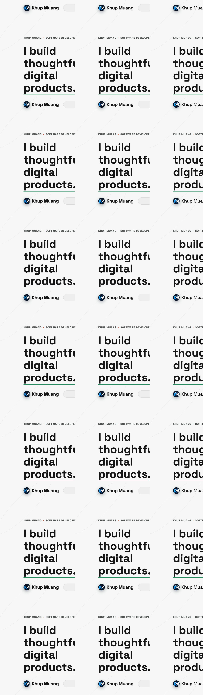
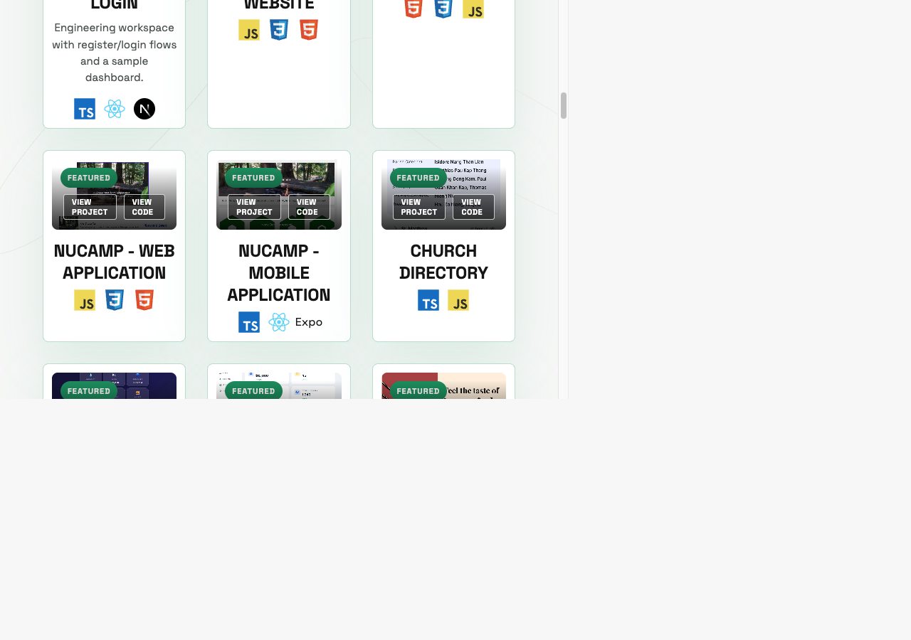

# Khup Muang — Software Developer Portfolio

A fast, fully responsive personal portfolio built with vanilla HTML, CSS, and JavaScript — no frameworks, no build step. It showcases selected projects, technologies, and a working contact form.

**Live site →** [kmuang.github.io](https://kmuang.github.io/)

---

## Preview



---

## Sections

### Hero
Introduces Khup Muang with a headline, short bio, and an autoplay video clip alongside the profile photo.


### Skills Marquee
An infinite horizontal marquee of 24 technology logos (HTML, CSS, JavaScript, TypeScript, React, Next.js, Node.js, Python, Java, MongoDB, MySQL, PostgreSQL, Docker, AWS, Azure, Firebase, and more).

### Projects
A responsive CSS grid of 18 projects. Featured cards are highlighted with a green badge and include a short description. Every card shows:
- Project screenshot with hover overlay links (View Project · View Code)
- Title and one-line description
- Tech-stack icons



### Contact
A two-column layout with a copy invite and a Formspree-powered contact form (name, email, message). Submission state is handled client-side with success/error feedback.


---

## Tech Stack

| Layer | Technology |
|---|---|
| Markup | HTML5 (semantic) |
| Styles | CSS3 — custom properties, Grid, Flexbox, `@keyframes` |
| Scripts | Vanilla JavaScript (ES2020) |
| Fonts | [Space Grotesk](https://fonts.google.com/specimen/Space+Grotesk) via Google Fonts |
| Form | [Formspree](https://formspree.io/) |
| Hosting | GitHub Pages |

---

## Features

- **Dark / Light mode** — toggled by a header button, persisted in `localStorage`
- **Skills marquee** — smooth infinite scroll, pauses on hover, respects `prefers-reduced-motion`
- **Project cards** — hover overlay, click-to-modal with full description and tech tags
- **Responsive layout** — 3-column → 2-column → 1-column across breakpoints; 2-column grid on mobile
- **PWA-ready** — `manifest.webmanifest`, theme-color meta, all icon sizes (32 × 32 to 512 × 512)
- **Accessible** — semantic HTML, `aria-label` on all icon links, `role="status"` on form feedback, keyboard-navigable modal (Escape to close)

---

## Project Structure

```
kmuang/
├── index.html              # Single-page markup
├── style.css               # All styles (custom properties, responsive breakpoints)
├── script.js               # Project data, card rendering, modal, theme, marquee
├── manifest.webmanifest    # PWA manifest
├── img/                    # Profile photo, video, project screenshots, icons
└── screenshots/            # README preview images
```

---

## Running Locally

No build step required — just open the file:

```bash
# Option 1 — open directly
open index.html

# Option 2 — serve with any static server
npx serve .
# or
python3 -m http.server 8080
```

---

## Contact

Built and designed by **Khup Muang**.  
Reach out via the [contact form](https://kmuang.github.io/#contact) on the live site or connect on:

- GitHub — [@kmuang](https://github.com/kmuang)
- LinkedIn — [khupmuang](https://www.linkedin.com/in/khupmuang/)
